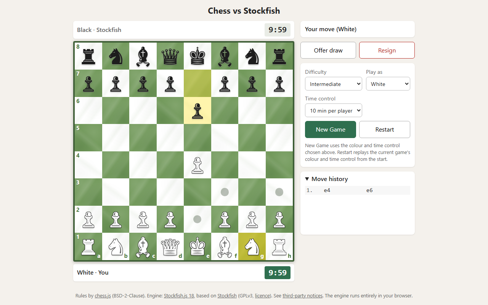

# Chess vs Stockfish

A chess website where you play against the Stockfish engine. It is a plain static site
(HTML + CSS + JavaScript). There is **no backend, no database, no account, no API key**:
the engine runs inside each visitor's browser.



## Features

- Click/tap a piece, then a destination square, **or drag the piece** with the mouse or a finger. Legal moves are highlighted (dots; rings for captures). An illegal drop puts the piece back.
- The selected square, the last move and a king in check are all highlighted.
- Play as White or Black (the board flips; the computer moves first when you're Black).
- Every rule comes from chess.js: castling, en passant, promotion (choose Q/R/B/N, or cancel), check, checkmate, stalemate, threefold repetition, insufficient material and the 50-move rule.
- Seven difficulty levels: Beginner, Casual, Intermediate, Advanced, Hard, Master, GrandMaster.
- Chess clock: 3, 5, 10 or 15 minutes per player (see [Chess clock](#chess-clock)).
- Offer draw (Stockfish decides with a documented rule, see [Draw offers](#draw-offers)) and Resign (with a confirmation step).
- Green marble board with a–h / 1–8 coordinates. h1 and a8 are light squares, as on a real board.
- Move history in standard algebraic notation (SAN). It sits in the side panel on desktop and is collapsible on phones.
- "Computer is thinking…" indicator. The board and settings are locked while the engine thinks.
- New Game (uses the colour and time control selected) and Restart (same colour and time control as the current game).
- A clear error message and a Retry button if the engine can't load or crashes.

## How it works

```
index.html ─► js/main.js   controller: game flow, buttons, status text
                 ├─ lib/chess.js/chess.js   chess.js — the RULES (referee)
                 ├─ js/board.js             draws the board, reports clicks and drags, promotion picker
                 ├─ js/clock.js             the chess clock (time maths only)
                 ├─ js/config.js            difficulty table, draw-offer rule + small helper functions
                 └─ js/engine.js            talks to the Stockfish Web Worker
                        │ postMessage("position fen …", "go movetime 600")
                        ▼
                 engine/stockfish-18-lite-single.js  (+ .wasm)   the OPPONENT, in its own thread
                        │ postMessage("bestmove e7e5")
                        ▼
                 main.js → chess.move(...) → board redraws
```

### chess.js vs Stockfish: who does what?

| | chess.js | Stockfish |
|---|---|---|
| Job | Referee | Opponent |
| Knows | Which moves are legal, check/mate/draw, move notation, history | Which move is *good* |
| Used for | Highlighting legal moves, rejecting illegal ones, game-over detection, the SAN move list | Choosing the computer's move only |

The board never decides anything itself. It asks chess.js. Even the engine's move is
passed through `chess.move()`, so an invalid engine reply could never corrupt the game.

### How the engine communicates

Stockfish is compiled to WebAssembly and runs in a **Web Worker**, a background thread,
so the page never freezes while it thinks. The two sides exchange text messages in the
standard **UCI** format (see `js/engine.js`):

1. Startup: `uci` → engine lists its options and replies `uciok` → `setoption name Hash value 64` → `isready` → `readyok`.
2. Computer's turn: `setoption` for `UCI_LimitStrength`, `Skill Level` and (for Elo-limited levels) `UCI_Elo`, then `position fen <position from chess.js>`, `go depth D movetime T` → … → `bestmove e7e5` (a promotion looks like `e7e8q`).
3. Draw offer: the same strength options set to full strength, `position fen …`, `go movetime 1000`; the last `info … score cp N` (or `score mate N`) line before `bestmove` is the evaluation.
4. New Game / Restart: if a search is running, `stop`, then wait for its (discarded) `bestmove`, then `ucinewgame`, `isready`.

Files needed for the engine (all in `engine/`):

| File | Purpose |
|---|---|
| `stockfish-18-lite-single.js` | The worker script (loader + glue code). Loaded with `new Worker(...)`. |
| `stockfish-18-lite-single.wasm` | The compiled engine with its built-in neural network (~7 MB). The `.js` finds it automatically by swapping `.js` → `.wasm` in its own URL, so keep both files together with matching names. |
| `Copying.txt` | The GPLv3 licence. Required. |

The "lite single-threaded" build was chosen because:
- it is about 7 MB (the full build is over 100 MB);
- it does not need the special COOP/COEP server headers that multi-threaded WebAssembly requires, so it works on any simple static server or host.

## Running it locally

Browsers block Web Workers and ES modules on `file://` pages. **You must serve the folder
over `http://`.** Double-clicking `index.html` will not work.

**Option A: Python (already installed on this PC)**
```
cd path\to\chess
python -m http.server 8000 --bind 127.0.0.1
```
Then open <http://localhost:8000>. (`npm start` runs the same command.)
`--bind 127.0.0.1` keeps the server private to your own computer. Without it, Python
shares the whole folder with every device on your network.

**Option B: VS Code "Live Server" extension**
Install *Live Server* (by Ritwick Dey), open the folder in VS Code, right-click `index.html` → **Open with Live Server**.

No `npm install` is needed to *run* the site. npm is only needed for the tests.

## Difficulty settings

Defined in `js/config.js`. The engine stops at whichever limit it reaches first.

| Level | Strength limit | Max depth | Max time per move |
|---|---|---|---|
| Beginner | `Skill Level` 0 (no Elo limit) | 1 half-move | 100 ms |
| Casual | `UCI_Elo` 1400 | no limit | 300 ms |
| Intermediate (default) | `UCI_Elo` 1800 | no limit | 500 ms |
| Advanced | `UCI_Elo` 2200 | no limit | 800 ms |
| Hard | `UCI_Elo` 2400 | no limit | 900 ms |
| Master | `UCI_Elo` 2600 | no limit | 1000 ms |
| GrandMaster | none (`UCI_LimitStrength` off, `Skill Level` 20) | no limit | 3000 ms |

- **UCI_Elo** (with `UCI_LimitStrength` on) is Stockfish's built-in Elo limiter. This build accepts 1320–3190, so Beginner, which needs to be weaker, uses `Skill Level` 0 and a 1-half-move search instead.
- **GrandMaster** turns every limit off and gets the longest thinking time. The engine's hash table is set to 64 MB at startup (default 16 MB). This build is single-threaded, so `Threads` stays at 1.
- Every move re-sends all strength options, so switching level mid-game never leaves an old limit behind. Options are only sent if the engine reports supporting them (Stockfish 18 does).

The Elo numbers are Stockfish's own calibration (made at a longer time control against other engines). They are a rough guide, not an exact human rating. To adjust, edit the `DIFFICULTY` table.

## Chess clock

- Choose 3, 5, 10 or 15 minutes per player (no increment) before pressing **New Game**. Your clock is shown below the board, Stockfish's above it; the running clock is green, and turns red under 20 seconds.
- The clocks start with the first move of the game. After each legal move the mover's clock stops and the opponent's starts; illegal moves change nothing. Stockfish's thinking time comes off Stockfish's clock.
- Time is computed from timestamps (`performance.now()`), not by counting timer ticks, so it does not drift and stays correct when the tab is in the background (browsers slow timers down there). A timeout that happened in the background is reported as soon as the page runs again, and a move can't be made after your time ran out.
- When a clock reaches zero the game ends: the other side wins, except that it is a draw if the other side has only its king left (it could never checkmate).
- The clock is paused while Stockfish considers a draw offer, and while the engine has failed (until Retry works).
- So that Stockfish doesn't lose on time in fast games, its thinking time per move is capped at 1/30 of its remaining clock time (minimum 50 ms). With plenty of time on the clock the difficulty settings above apply unchanged.

## Draw offers

Stockfish has no built-in way to accept or decline a draw, so the game uses this fixed rule (`decideDrawOffer` in `js/config.js`):

1. You can offer a draw on your turn. While Stockfish considers it, the board is locked and both clocks are paused.
2. Offers **before move 20** are declined ("too early").
3. Otherwise Stockfish analyses the position at **full strength for 1 second** (whatever the difficulty level) and the game reads its evaluation.
4. It **accepts** if, from its own point of view, the evaluation is **+0.20 pawns or less** (equal or worse for it), or if it sees a forced checkmate against itself.
5. It **declines** if it thinks it is better than that, or sees a forced checkmate for itself. The reason is shown, and play continues from the same position with the same clock times.

**Resign** asks "Resign this game?" first. *Yes, resign* ends the game and Stockfish wins; *Cancel* continues the game.

## What runs where

Everything runs **locally in the visitor's browser**:
- the rules (chess.js), the board, the game logic;
- the engine (Stockfish WebAssembly, in a Web Worker).

The web server only delivers static files once (HTML, CSS, JS, the engine's `.wasm`). After
that, no network requests are made for chess calculations. This is verified by an automated
test that records every request (see Testing below). The footer links point to the
source code pages; they are ordinary links, not requests the game makes.

## Testing

```
npm install                       # one time: installs Playwright (dev-only)
npx playwright install chromium   # one time: downloads the test browser
npm test                          # Node tests: rules, helpers, and the real engine
npx playwright test               # browser tests (starts a Python server automatically)
```

To run the browser tests against a deployed copy instead of the local server, set `BASE_URL`:
`BASE_URL=https://chess-vs-stockfish-ebb7317f.netlify.app npx playwright test`
(in PowerShell: `$env:BASE_URL="https://…"; npx playwright test`).

- `tests/unit.test.mjs`: helper functions (including square colours, clock maths, the draw-offer rule and timeout results), plus chess.js on specific positions (illegal moves, castling, en passant, all promotions, checkmate, stalemate, threefold, insufficient material, 50-move rule, status messages).
- `tests/engine.test.mjs`: loads the real `engine/` files in Node. It checks every level returns legal moves in time, that GrandMaster finds a mate-in-one, that promotions are reported, that the evaluation used for draw offers has the right sign, and that `stop` safely interrupts a search.
- `tests/e2e.spec.mjs`: real Chromium, clicking the page. It covers moving and the reply, illegal clicks, playing as Black, each difficulty, locking while thinking, Restart (including mid-search), castling, en passant, the promotion picker, checkmate by player and by computer, stalemate, the check highlight, a blocked `.wasm` (error and then Retry), a missing engine script, a phone-sized screen (`screenshots/mobile.png`), and a network log proving only local files are requested. Also: square colours in both orientations, mouse drag-and-drop (legal, illegal, opponent pieces, while the engine thinks, castling, en passant, promotion), touch dragging on a phone layout, the clocks (start, switching, illegal moves, engine thinking time, every time control, timeout using Playwright's fake clock), draw offers accepted and declined, and resign/cancel/New Game.

`?fen=<FEN>` in the URL starts games from that position. The tests use it, and it is handy for trying special positions by hand.

## Troubleshooting

| Problem | Fix |
|---|---|
| "Loading the engine…" forever, or an engine error | Open the site via `http://localhost…`, not `file://`. Check that both `engine/stockfish-18-lite-single.js` and `.wasm` exist with matching names. Press **Retry** or reload. |
| Engine error appears after about 15 s | The `.wasm` could not be downloaded or started (missing file, blocked by an extension, or a very old browser). Check the browser DevTools Console and Network tabs. |
| Blank page, console says "Failed to load module script" / MIME type | Your server is sending `.js` with the wrong type. Use Python or Live Server as above. |
| Pieces look like coloured emoji | Rare on very old phones that ignore the text-style selector. The pieces still work. |
| Playwright says "did not expect test() to be called here" on Windows | The terminal's folder path has different upper/lower case than the real folder name (e.g. `Chess` vs `chess`). `cd` into the folder using its exact on-disk name and run again. |
| Hosting on GitHub Pages / Netlify | Upload **only** `index.html`, `css/`, `js/`, `lib/`, `engine/` and `THIRD_PARTY_NOTICES.md` (plus `README.md` if you like). Do **not** upload `.claude/`, `tasks/` (contains local file paths), `node_modules/`, `tests/`, `test-results/`, `screenshots/` or the npm/Playwright config files. Most hosts already serve `.wasm` correctly as `application/wasm`. |

## Project layout

```
index.html, css/style.css, js/*.js     the website
lib/chess.js/                          chess.js 1.4.0 + LICENSE
engine/                                Stockfish.js 18 lite single-threaded + Copying.txt
tests/, playwright.config.mjs, package.json   development/testing only
THIRD_PARTY_NOTICES.md                 versions, sources, hashes, licences
tasks/todo.md                          build checklist and review notes
```

## Licences and third-party sources

| Component | Version | Licence | Source |
|---|---|---|---|
| Stockfish.js (engine) | 18 (npm `stockfish@18.0.8`, lite single-threaded build) | **GPL-3.0** (`engine/Copying.txt`) | https://github.com/nmrugg/stockfish.js, based on https://github.com/official-stockfish/Stockfish |
| chess.js | 1.4.0 | BSD-2-Clause (`lib/chess.js/LICENSE`) | https://github.com/jhlywa/chess.js |
| Piece symbols | Unicode | — (system fonts, nothing bundled) | — |
| Playwright (tests only) | 1.63.0 | Apache-2.0 | https://playwright.dev |

See `THIRD_PARTY_NOTICES.md` for exact package URLs, git commits and file hashes. The
third-party files are unmodified. Keep their licence files and notices.

**About the GPL:** Stockfish is licensed under GPLv3. Publishing this website means you
distribute Stockfish to your visitors. You must:
- keep `engine/Copying.txt`;
- keep the copyright notices;
- make the corresponding source code available (the footer and `THIRD_PARTY_NOTICES.md` link to it).

Your own code talks to the engine only through text messages. The simplest safe choice
is to release your own code under GPLv3 too. If licensing matters for your use case,
check with someone qualified. This README is not legal advice.
